# AegisLatch

**Security-first authorization for AI agent tool calls.**

> **Public open-source developer preview · v0.1.0**
>
> AegisLatch is a Python library for placing a deterministic, **default-deny permission gate** between an AI agent's proposed tool call and a trusted application handler. It is **not** an autonomous AI model, a complete firewall, a running dashboard, an MCP proxy, or independently audited production security software.

**Created / developed by: Umer Hassan**  
**Repository:** https://github.com/jamesjoycewatches-boop/aegislatch

## Animated workflow preview

*Conceptual animation of an AI tool-call lifecycle: proposed action → trusted host → default-deny policy → allow, human review or deny → audit evidence. This is an illustrated workflow, not screenshots of an existing graphical application.*

The project helps developers put policy evaluation in front of sensitive tool handlers. **AegisLatch is a Python authorization library**; embedding and sandbox enforcement must be supplied by the application. See the [quick start](#quick-start), [security model](#security-model-and-limits), [threat model](docs/THREAT_MODEL.md), and [MIT license](LICENSE).

## Why AegisLatch?

AI agents can be given access to files, APIs, databases, messaging systems and code-execution tools. A prompt-injected or simply mistaken agent can propose actions that exceed the user's intent. AegisLatch lets application developers enforce an explicit policy *outside the model* before a registered tool handler runs.

Its core principle is **never trust a model-generated tool request as authorization**. The trusted host must authenticate the user, register tools and policies, and make the gateway the sole execution path.

### Design goals

- **Least privilege by default:** unknown tools and principals are denied.
- **Deterministic decisions:** the same policy and call produce the same authorization result.
- **Separation of duties:** human approval is issued by a trusted service, not by the agent.
- **Privacy-conscious operation:** local policy processing, no built-in telemetry, no model API key.
- **Small, inspectable core:** Python 3.11+ standard library with zero third-party runtime dependencies.
- **Honest security boundaries:** document what checks can and cannot enforce.

## Security features

| Capability | v0.1 behavior |
| --- | --- |
| Default-deny policy | Exact authenticated `principal`, trusted `server` and `tool` rules return **allow**, **deny** or **review**. |
| Controlled file paths | Canonical-path containment under configured roots; prevents straightforward traversal and symlink escapes at evaluation time. |
| HTTPS destinations | HTTPS-only, exact allowed hostname matching; forbids embedded URL credentials, IP literals, unusual ports and certain suspicious query parameters. |
| Secret-pattern checks | Rejects common API-key/token patterns and certain sensitive argument field names. This is best-effort, **not full DLP**. |
| Schema integrity | Optional SHA-256 pinning of a trusted canonical JSON tool definition provided by the host. |
| Human approval | Short-lived, HMAC-signed, single-use ticket tied to the exact call and rule; SQLite helps reject replay. |
| Audit evidence | Optional local HMAC chain records a decision, rule ID and action fingerprint **without raw arguments**. |
| Operational isolation | No built-in network requests, telemetry or runtime cloud service. Execution is delegated to an application-supplied handler. |

### How a call flows

~~~text
AI MODEL (untrusted proposed tool call)
                  |
                  v
TRUSTED HOST (authenticated principal + tool registry + policy)
                  |
                  v
      AegisLatch Policy.evaluate()
                  |
       +----------+-----------+
       |          |           |
      DENY       REVIEW      ALLOW
       |          |           |
       |       Trusted human  |
       |       approval       |
       |          |           |
       +----------+-----------+
                  |
                  v
       Gateway.execute()
                  |
                  v
    REVIEWED, SANDBOXED HANDLER
    + OS / network enforcement
~~~

**Important:** If an AI agent can call the handler directly, AegisLatch cannot stop that bypass. The host must restrict the available execution routes and handler privileges.

## Quick start

### 1. Requirements

- Python **3.11 or newer**
- Git
- No model subscription, cloud API key or third-party runtime package required

### 2. Install from this repository

~~~bash
git clone https://github.com/jamesjoycewatches-boop/aegislatch.git
cd aegislatch
python -m pip install -e .
~~~

The package is currently distributed as GitHub source. These commands **do not** assume a PyPI release.

### 3. Run the included offline example

~~~bash
python examples/demo.py
~~~

The demonstration reads only a harmless sample note in the example workspace through a permitted handler. It does not contact any external server.

### 4. Inspect a blocked call from the command line

~~~bash
python -m aegislatch check examples/policy.json examples/blocked-call.json
~~~

Expected result: a **deny** decision and process exit code **2** for the disallowed shell request.

### 5. Run tests and repository checks

~~~bash
python -m unittest discover -s tests -v
python scripts/release_gate.py
python -m compileall -q src
~~~

GitHub Actions also runs installation, hygiene checks, tests and compilation on **Python 3.11, 3.12 and 3.13**. A green CI run is a regression check, **not a security certification**.

## Writing a policy

Policies are local JSON documents. A valid policy has `version`, `default` and `rules`; the default must be `deny`. Each rule identifies a user/principal, server, tool, decision and resource restriction.

Example based on the included demonstration:

~~~json
{
  "version": 1,
  "default": "deny",
  "rules": [
    {
      "id": "read-workspace-note",
      "principal": "demo-user",
      "server": "local-demo",
      "tool": "read_note",
      "effect": "allow",
      "resource": {
        "kind": "file",
        "arg": "path",
        "roots": ["./workspace"]
      }
    },
    {
      "id": "external-post-needs-review",
      "principal": "demo-user",
      "server": "web-demo",
      "tool": "send_payload",
      "effect": "review",
      "resource": {
        "kind": "url",
        "arg": "url",
        "hosts": ["api.example.com"]
      }
    }
  ]
}
~~~

Relative file roots are resolved relative to the policy file's directory. An incoming file resource argument must be an **absolute path**. Hostnames must match the allowlist exactly; a wildcard or approximate substring match is not accepted.

### Embedding the gateway

~~~python
from pathlib import Path
from aegislatch import Gateway, Policy, ToolCall

policy = Policy.from_file("examples/policy.json")
sample = (Path("examples/workspace") / "hello.txt").resolve()

call = ToolCall(
    principal="demo-user",  # MUST come from the trusted authenticated host
    server="local-demo",
    tool="read_note",
    arguments={"path": str(sample)},
)

def trusted_read_note(path: str) -> str:
    # Demo only. Production needs safe file-descriptor operations and sandboxing.
    return Path(path).read_text(encoding="utf-8")

result = Gateway(policy).execute(call, trusted_read_note)
print(result.strip())
~~~

**Do not allow the LLM to choose its own authenticated identity.** Do not expose unwrapped file, shell or network tools to the agent.

## Human approval and audit logging

The `review` decision is intentionally **not automatic approval**. A separate trusted, human-operated component must show the exact proposed arguments and issue a time-limited ticket only after verification. The `ApprovalAuthority` signs that ticket and uses a local SQLite record to detect replay. Tickets are bound to the call's fingerprint and policy rule.

An optional `AuditLedger` chains decision events with HMAC. It records timestamps, decision status, rule ID, reason and an action hash; it does not intentionally store the raw tool arguments. The chain helps detect modifications **only when its signing key and file are protected**. Deletion, key compromise and multi-writer use require additional safeguards.

See [the working demo](examples/demo.py), [approval implementation](src/aegislatch/approvals.py), [gateway implementation](src/aegislatch/gateway.py) and [audit implementation](src/aegislatch/audit.py).

## Security model and limits

AegisLatch is **one authorization layer**; it is not a substitute for a sandbox, a filesystem access-control mechanism, DNS/firewall rules, endpoint protection, or a human-reviewed security architecture.

- **Filesystem:** the policy performs path checks, but symlink/path changes between checking and opening a file (TOCTOU) remain possible. Enforce safety in the handler using OS permissions and safe file-descriptor primitives.
- **Network:** hostname allowlists alone do not stop DNS rebinding, redirects, SSRF through an HTTP client or infrastructure-level bypasses. Apply IP/redirect checks and independent egress filtering.
- **Secrets and privacy:** simple patterns cannot catch every secret, encoded payload, sensitive content or exfiltration path. Use data classification and dedicated DLP where needed.
- **Approvals:** signing keys and approval APIs must be separated from agents. Do not let a model mint its own permission tickets.
- **Tool execution:** an allowed tool can still behave dangerously if its handler is unsafe or overprivileged.
- **Audit:** logging is HMAC-tamper-evident under limited assumptions, not tamper-proof or immutable.
- **Deployment:** independent penetration testing, threat simulation and production integration review are **not yet complete**.

Read [SECURITY.md](SECURITY.md), [the threat model](docs/THREAT_MODEL.md), [the initial security review](docs/SECURITY_AUDIT.md) and [the release checklist](docs/RELEASE_CHECKLIST.md) before integrating it with sensitive systems.

## Example use cases

- **Personal AI assistants:** prevent unapproved access to local files or external messaging tools.
- **Developer agents:** restrict dangerous tool calls and prevent unexpected shell operations.
- **Enterprise prototypes:** introduce explicit rules per authenticated user, tool and resource.
- **Agent platforms:** require human review before a selected high-impact operation.
- **Security research:** exercise adversarial cases against a small, inspectable authorization engine.

These are integration scenarios, **not claims of existing plug-and-play integrations**.

## What's included

~~~text
aegislatch/
├── src/aegislatch/         # policy engine, gateway, approvals, audit, CLI
├── tests/                  # unit and adversarial regression tests
├── examples/               # offline demo, JSON policy, blocked-call sample
├── docs/                   # security audit, threat model, release checklist
├── .github/workflows/      # CI test matrix (3.11, 3.12, 3.13)
├── SECURITY.md
├── CONTRIBUTING.md
├── LICENSE
└── pyproject.toml
~~~

## Roadmap

Planned research/development directions (not current capabilities):

1. Authenticated MCP adapter or proxy integration with trusted tool registration.
2. Safe file-descriptor APIs and platform sandbox integrations.
3. Network egress verification and redirect/DNS defenses in host adapters.
4. Dedicated approval UI and approval issuer separation.
5. Stronger audit checkpoints and multi-process support.
6. More adversarial/property-based tests, dependency/SBOM analysis and independently reviewed releases.

## Contributing

Issues, documentation improvements, reproducible test cases and reviewed security contributions are welcome. Read [CONTRIBUTING.md](CONTRIBUTING.md). **Do not include credentials, customer data, private code or exploit details in public issues.** See [SECURITY.md](SECURITY.md) for the vulnerability-reporting approach.

## Maintainer and license

**Developed by Umer Hassan.** AegisLatch is an independent open-source developer project.

Distributed under the [MIT License](LICENSE). This release is a **public developer preview**, supplied without security guarantees. It has not received an independent security certification.
